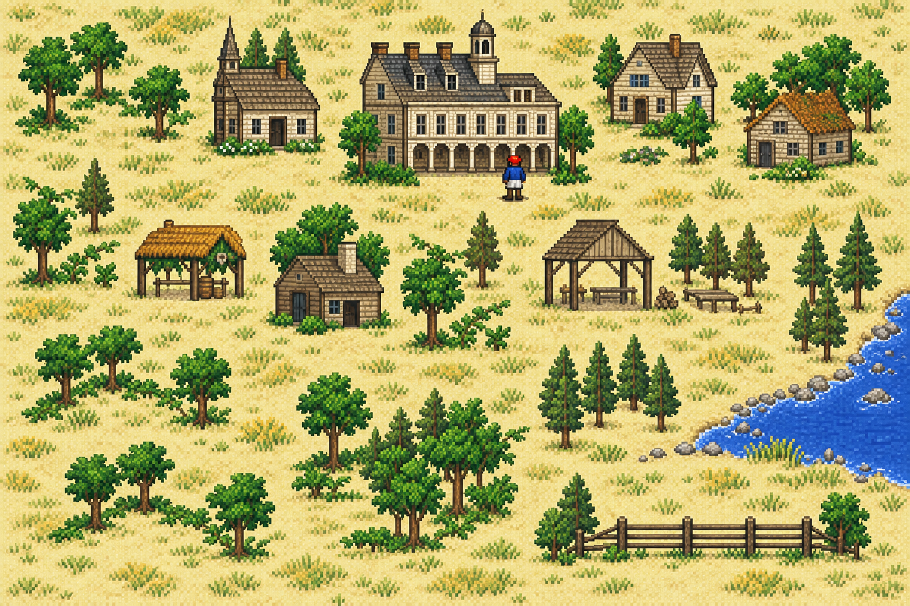

# 多語系、圖像 HD 與實際遊玩影片

狀態：R150中文修正、三平台雙類完整版及新版90秒建城影片已交付v.1.0.9-20261022，剩餘人工待驗。Ada離線暫存清理仍由本地清單追蹤。

## R150影片英文欄位修正

已分離無HD包的文字來源觀測，沿現用譯稿補接發現陸地、登陸、建城命名、城內標題、無船、側欄狀態及四個片頭／操作欄位。九個指定繁中畫面已見中文，字級從各欄原生墨跡量測。來源未完整時仍回原文，不以放寬守門消除暫態英文。入口[規格060 R150](../spec/060-language-bundle-swap.md#r150繁中影片欄位-display-pass)。

六包與影片位於[目前交付](../../dist-all/v.1.0.9-20261022/SHA256SUMS.json)，來源及限制見[目前狀態表](../../CONTEXT.md)。影片是R148正常GUI輸入在本版正式畫布的重播擷取，從空存檔建立首城鎮，HD段正常載入新產生的同一存檔。完整遊戲區、字幕及13張抽樣通過；原版OPL錄音作後製配樂，未重新確認GPU。Ada仍SSH逾時，遠端 /home/user/colonization-workplace/r150 尚待連線恢復後刪除。持續暫存與清理授權已取得，不另詢問。遠端Issue #64保持CLOSED，只有本地清單保留清理追蹤。

## R148交付結案

使用者明確接受現行接線與本機交付結案。v.1.0.8-20261021包含Linux、Windows、macOS各兩包，及90秒正常新局、航海、登陸、建立Jamestown與同存檔HD操作影片。交付與來源入口見[目前狀態表](../../CONTEXT.md)、[規格044 R148](../spec/044-release-and-promo.md#2026-10-21-r148-三平台完整版與建城實錄交付-ready)、[六包彙整器](../../tools/package_full_release.py)與[實錄影片工具](../../tools/build_gameplay_promo.py)。

#53、#55、#58至#60、#62至#64已遠端回讀CLOSED。既有譯稿、來源連結、普查與證據等級保持；未抽樣、原文回退、未觀測圖像、人耳與Windows／macOS真機交由人工登記。不宣稱所有情境全中文／全HD，不重跑全矩陣。Ada實際前端OpenGL與NVENC已確認使用RTX 2000 Ada，DOS運算仍在CPU；遠端私用原版與完整版暫存已刪除。

## 歷史範圍與分批證據

以下保留各批次當時的未完成敘述；目前交付狀態以上方R150為準，R148保留結案歷史。

2026-10-14使用者確認全量HD，包含小圖像。目標涵蓋所有玩家可見圖像與動畫幀，
包含商品、資源、單位、側欄圖示、按鈕、游標、背景、邊框、標題及事件圖。
已接線素材與最新驗證以[目前狀態表](../../CONTEXT.md)為準，完整覆蓋仍未完成。

主選單背景及重複底紋接續[規格069](../spec/069-hd-menu-background-and-textures.md)。
R66已以完整可見索引、原版選單邊框與來源底色核對，正式接入主選單背景與木紋，
R67接入世界與城內的WOODTILE木紋，R68再接入PARCH紙質背景，合計70種素材。VGA往返生命週期不宣稱已證實；
其餘圖像、特殊游標與動畫仍待接續，完整HD未完成。
來源檢查、像素檢查與正式驗收入口集中於規格069。
R69難度人物卡與國家旗卡背景已限定CONFORMED，當時72張生成原PNG均納入graphics。46項正常五語操作及實際GUI音訊驗證通過；其他圖像與動畫繼續由本目標追蹤。
R70自訂地圖十二張小圖背景已限定CONFORMED；現行206張生成原PNG及清冊收在graphics，含五艘船、貨車、砲台、寶藏、殖民者及其餘19幀步行／騎乘人物與受損砲台。各批正常操作、五語GUI、原版狀態與實際GUI音訊核對範圍見[目前狀態](../../CONTEXT.md)；完整HD與動畫仍由本目標追蹤。

單位小圖像依[規格070](../spec/070-hd-unit-small-images.md)與[131候選唯讀組裝器](../../tools/build_hd_unit_lifecycle_probe.py)驗證。R71正常載入至百科23種條目流程確認的80種來源，現均在各自已驗場景限定CONFORMED；共用小圖像層80來源／79張美術，第100幀沿人物層。R75其餘19幀通過正常14頁五語原版／HD、逐幀游標、原版完整狀態／實際GUI音訊／存檔及資源封裝驗收。其他51個ICONS候選未由R71流程觀測，其他格式仍屬全量範圍；百科不外推世界移動、戰鬥或動畫。R76殖民地部分背景COLONY.PIK與歐洲港口EUROPE.PIK已依規格069限定CONFORMED，107項五語正常GUI、67點獨立來源、四側原版狀態／實際GUI音訊及存檔通過。R77八種報告背景REPORT1至8也已限定CONFORMED，149項五語正常GUI、99點獨立來源與74筆實際輸入四側至262000000步通過；生成原PNG及完整提示已入graphics。後續接續19個未接線PIK、其他51個ICONS候選、其餘圖像與動畫；既有來源的世界移動與戰鬥仍須正常路徑驗證。完整範圍與下方退出條件保持。

R78國會室內CCBKGD與計分木紋WOODPANL已在正常F3第二頁／F10限定CONFORMED，合計134張生成原PNG。37項五語GUI、27點獨立來源、室內原版前景保留與四側原版狀態／音訊／存檔通過。載入選單仍因主畫布與可見影像差異回原圖；人物動畫未驗收，不能外推全量HD完成。其餘19個PIK、51個未觀測ICONS候選、其他格式與動畫繼續由本目標追蹤，詳[規格069](../spec/069-hd-menu-background-and-textures.md)。

R79正常讀檔列表與成功訊息的背景已依規格069限定CONFORMED。215項具名Go、32項五語GUI與獨立原版來源、31筆實際輸入四側原版狀態／WAV／存檔通過；134張原PNG保持。已送到VGA的來源獨立於後續主畫布改寫，未知VGA寫入仍撤銷。該路徑原版游標與翻譯字底接縫待處理，不能稱完整讀檔UI或全量HD完成。

R80再完成已發布來源的字底、透明游標背景與不透明游標還原，正常五語兩模式及文字內游標操作限定CONFORMED。251個具名Go、32項GUI／獨立原版來源與實際輸入四側原版狀態、音訊及存檔通過；134張原稿保持。未知成功訊息字底、其他圖像及動畫仍待完成，詳[目前狀態](../../CONTEXT.md)。

R81接續完成正常讀檔成功訊息的WOODTILE木紋與字底。63個具名Go、32點既有正常輸入來源／狀態、9項當次正常GUI及三側實際輸入重播通過；不把R80五語範圍算成本批新驗收。134張原稿及原版資料保持。PARCH發布零正例保留，其他圖像及全量HD仍由本目標追蹤。開場R82另沿既有目標025／146核對長圖、邊框、動畫與靜態題字，詳[規格069](../spec/069-hd-menu-background-and-textures.md)。

R82開場OPENING.PIK長圖與OPENBORD.PIK邊框限定CONFORMED，新增13張原PNG，合計147張。88個具名Go、192點原版來源／完整狀態、六項正常GUI及四筆實際輸入三側至20000000步通過；繁中滑鼠矩形只恢復已驗背景。原版SS移動船、其他動畫與未驗淡入淡出保留原圖。其餘17個PIK、其他圖像及完整HD繼續追蹤。實際收據、指紋與重生入口見[規格069 R82](../spec/069-hd-menu-background-and-textures.md)。

R83船隻八幀與R85太陽七幀、閉眼底圖及右側裁切已限定CONFORMED，現行163張原PNG已納入graphics。R85另完成四語字幕游標恢復，新組建兩組實際輸入三側原版狀態、WAV與存檔一致；七幀正常畫面與新字幕修正的繼承界線見[規格069](../spec/069-hd-menu-background-and-textures.md)。其餘雲、煙、海怪動畫與17個PIK仍待接線，完整HD與新版交付未完成。

R86雲十幀與煙十一幀已限定CONFORMED，正常63項GUI、完整RGBA／X11及當次13筆輸入三側原版狀態、WAV與存檔全等；來源清冊184個已驗連結。R87完整魚形21幀與清除背景已依READY正式接線，原PNG合計206張；正常144點及21張完整RGBA、207檔封裝通過，正式GUI與完整重播持續。其餘17個PIK、其他圖像與動畫、完整五語、影片及新版交付仍待完成，詳規格069與目前狀態表。

本輪承接使用者於 2026-10-10 的新增要求。已發布的
v.1.0.3-20261010 與 #56 完成紀錄保留；本頁不代表新增功能已完成。
未完成項由 [工作清單](../worklist.json) 掛接 GitHub Issue。

工作入口：[五語與英數字型 #62](https://github.com/wicanr2/colonization_cht/issues/62)、
[HD 重繪 #63](https://github.com/wicanr2/colonization_cht/issues/63)、
[實際遊玩影片 #64](https://github.com/wicanr2/colonization_cht/issues/64)。

下一類HD素材接續[規格062](../spec/062-hd-sea-draw-lifecycle.md)與
[唯讀海洋繪製探針](../../tools/probe_hd_terrain_draws.go)，先追PHYS0.SS第148幀。
[來源鏈檢查器](../../tools/check_hd_terrain_draws.py)交叉核對原版狀態與既有完整像素定位。
首座建築與海洋第148幀已接正式組裝、啟動器及封裝，規格061／062限定CONFORMED。692Go零skip、31反例、182組正式五語GUI及121筆實際輸入四側重播通過；完整原版狀態、WAV與存檔一致。八種缺件／恢復及八項封裝拒絕通過，完整HD及新版交付仍未完成。
正式來源、組裝、GUI及重播入口集中於[規格062正式契約](../spec/062-hd-sea-draw-lifecycle.md#2026-10-13正式接線契約)。[背景還原附記](../spec/062-hd-sea-draw-lifecycle.md#2026-10-12背景保存與還原的限定證據)保留R34來源鏈；正式v3降低與原版岸線的色差，缺件回退已驗。其他海岸／地形、還原鏈、裁切、動畫及跨平台效能仍待審查。

人物接續[規格063](../spec/063-hd-person-draw-lifecycle.md)，先驗正常殖民地畫面的ICONS.SS第100幀。
已驗13次完整人物繪製、4545筆矩形寫入、49點原版狀態及存檔，15個錯誤證據全拒絕。
人物第100幀已正式接入，規格063限定CONFORMED；採用使用者確認的v2原圖與alpha。
699Go零skip、17人物及31海洋反例、252組正式五語視窗、229筆實際輸入四側重播通過。
11種缺件／錯件／連結及恢復、11個封裝反例均通過；其他人物、動畫及完整HD未完成。

城內十二種建築與景物已依[規格064](../spec/064-hd-colony-building-batch.md)限定CONFORMED，
與海洋及人物合計十四種正式HD素材。原始生成PNG及alpha原樣保存，原版參考仍只留本機。
世界第079幀依[規格062](../spec/062-hd-sea-draw-lifecycle.md) R58限定CONFORMED，與海洋共用既有觀測，合計45種正式素材。827Go零skip與go vet、92組五語GUI、20點獨立來源／330992個像素、實際輸入四側及正常play=true通過。原版狀態、WAV與存檔保持；固定Linux ABBA成本比例1.1623。全量地形、游標、背景與動畫仍待完成。
商品、資源、其他單位、游標與其餘小圖像皆列入全量目標，尚未完成接線。
31來源群組依[規格065](../spec/065-hd-small-images.md) R57完成30張小圖像的限定CONFORMED，第100幀沿既有人物層。規格065 R57限定CONFORMED，30張小圖像、世界5種與城內28種，合計44種正式素材／清冊45檔。826Go零skip與go vet、49點原版狀態／存檔、633來源／RAM及125載入反例通過。102組五語GUI、111點獨立原版模型與7529424個RGBA像素相同；187筆實際輸入四側至327600000步，完整原版狀態、WAV及存檔保持。45種本批新行程與136項封裝拒絕通過。守門回退0組另記，不計持續HD，五語城內來源恢復。正式play=true驗28張城內圖像，frames為0。 其餘圖像、游標與動畫仍待接續，全量HD尚未完成。
未知後畫與游標維持回原圖並記錄來源；此安全回退不計為已完成HD覆蓋。

十二種新世界地形依[規格067](../spec/067-hd-world-terrain-batch.md) R63限定CONFORMED，
合計58種正式素材。正式來源及最新驗證以[目前狀態表](../../CONTEXT.md)為準；
其餘玩家可見圖像與動畫仍屬全量目標，沒有新發行。

八種8×8世界碎片依[規格068](../spec/068-hd-small-world-terrain.md) R64限定CONFORMED，
合計66種正式素材。898Go分兩批完成、100組五語GUI、89點原版及四側165筆輸入通過。
其餘七個新槽位的本次零例限制保留；全量HD、其他圖像與動畫未完成。

## 已確認的要求

| 項目 | 使用者決定 |
|---|---|
| 語言 | 保留繁中，新增簡中、日文、韓文、英文，提供切換。 |
| 字型 | 英文模式使用原版字體；其他語言內保留的英文字母與數字使用該語言的顯示字型。 |
| 圖像 | 2026-10-14確認全量HD，包含所有玩家可見小圖像、背景與動畫幀。沿2026-10-11定稿的第一張精細像素風；圖像來源、比例、位置與互動範圍依原版證據。 |
| 操作 | 2026-10-11確認採用畫面外設定列，可在遊玩中切換；開設定時暫停，關閉且按鍵放開後恢復，不占原版快捷鍵。 |
| 影片 | 推廣影片必須包含實際遊玩的連續動態畫面。 |
| README | 加入遊戲背景、殖民題材起源與當年北美移民情況。 |
| 交付 | 沿用本對話的 commit、push、三平台完整版與 Release 要求；新版須另建固定版本，不覆寫既有發行。 |

## 已查證的邊界

畫面外設定列、暫停、實體輸入放開後恢復及偏好保存依
[規格056](../spec/056-display-settings-runtime.md)，原版快捷鍵與存檔格式保持原樣。

五語整包後端已接入[正式組裝器](../../tools/build_window_prototype.py)、
[正式啟動器](../../tools/release/colonization-cht.sh)及[封裝器](../../tools/package_release.py)。
四語逐欄Noto與英文原版畫布的正式驗收依
[規格057](../spec/057-noto-runtime-atlas.md)及[規格060](../spec/060-language-bundle-swap.md)。
整包接線基準為75組正常GUI與八次重播，涵蓋改名取消、存檔及新行程讀回。
前批透明外緣修正另通過635Go零skip、go vet、50組五語GUI與四次實際輸入重播，
完整CPU、RAM、VGA、DAC、WAV及存檔一致。
正式啟動不需要隔離旗標；原文觀測與五語重建匯出另由診斷旗標控制。
本批沒有新Release，已發布版仍維持原狀。

64固定欄與3動態圖集、152組完整字格及95 ASCII沿已驗契約，
每欄依原版墨跡、基線與安全區選字。六列命令欄與五列主選單的早期證據另見
[規格054](../spec/054-noto-field-atlas-draft.md)及[規格055](../spec/055-noto-main-menu.md)。
固定組句由[規格059](../spec/059-display-phrase-templates.md)的TSV載入，
顯示翻譯不參與原版條件、資料查找或序列化。
[規格058](../spec/058-dialog-source-identity.md)的歷史冷啟動RAM一byte差異仍未知，
不能由本次不同正常路徑重標為已解。

城內90% (3)、1與4已依[規格052](../spec/052-retained-ascii-font.md)最新附記完成正式修正。
地圖完整雙語Jamestown四語已依[規格038](../spec/038-string-overlay-draft.md)最新附記限定CONFORMED，
字級23／23／17／22px，保留原版後畫像素；進城撤除，存檔返回世界重建。
最新676Go零skip、go vet、50組五語GUI與42筆實際輸入四側重播至113400000步通過，
完整CPU、RAM、VGA、DAC、WAV及存檔全等，城內十二個既有數值欄位保留。
本機重生入口為既有language-resources-20261011/map-source-padding-r27的
mapFormalApplyBuildR27.sh、mapFormalGUIR27.sh、mapFormalReplaysR27.sh及conformance-review.py；
限定審查指紋7a5769e5810ae966b764b79ba440803cab59af867c07fd9f491ef54af85383a2。
其他未驗來源及樣式仍回原文並記錄；完整可見來源生命週期、HD、影片與三平台新版交付仍須接續完成，
不增加普查shown或宣稱整個目標完成。

以下為目前程式可回查的 confirmed 事實，不是新版完成證據。

- [原版畫面合成](../../tools/live_menu.go) 在 `render` 內讀取 320×200
  索引畫面及色盤，對照組直接整數放大四倍；中文組經 `overlay.ComposeLayers`
  及後續覆蓋產生 1280×800 畫布。
- [前端](../../tools/window_prototype.go) 的 `Layout` 固定為 1280×800，
  `logicalMouse` 以座標除以四映回原版。F1～F10、方向鍵、數字鍵盤與部分
  Ctrl／Alt／Shift 組合已送進 DOS，不宜另拿來當設定快捷鍵。
- 已發布v.1.0.3-20261010的13份文字資料與67份字模資產只提供繁中。開發版五語整包後端已接線，
  可見欄位的翻譯與Noto排版仍依各規格的實際驗收範圍；其餘來源保持待驗，完整五語尚未完成。
- [Cubic 11](../../font/README.md) 的固定 SHA-256 為
  `8de9c249b92bc414cb73f09ddb76c7cb327edb3907b638f0d0bd22691237fd5c`。
  本輪用 Pillow 9.4 抽查 `A0%漢汉あア한글`；`한`、`글` 的遮罩與未定義碼點
  U+10FFFF 相同，其他抽查字元不同。這只證明抽查缺字，不等於完整字形清冊。
  該容器不作正式字模烘製工具。
- v.1.0.3 的影片是已揭露的截圖混剪。現有 PNG 與輸入收據能支援新錄影查證，
  不能直接改名當成連續遊玩影片。

## 決策樹

```text
使用者已確認：五語、英文原字體、HD 可切換、保留原版操作
├─ HD：全部玩家可見圖像，包含小圖像與動畫幀（2026-10-14已確認）
│  └─ 第一張精細像素風已定稿；逐項盤點來源、生成素材、接線及正常畫面驗收
├─ 設定入口：畫面外工具列，遊玩中切換（已確認）
│  └─ 開設定暫停、關閉及按鍵放開後恢復；接續輸入隔離證據與預設值
└─ 字型與語料：先盤點，再展示日韓候選與最長文案排版
   └─ 確認字型後，建立分語言資料包與逐欄規格
```

畫風與設定入口已確認。[規格050](../spec/050-display-settings.md)授權前端設定狀態、輸入隔離與音訊暫停。
語言包、字型與HD合成仍待各自的證據與規格，不因設定入口定案就視為可用。

## 切換介面的建議

已確認在遊戲區上方增加獨立、可辨識的「顯示設定」工具列。遊戲區仍維持
1280×800 及原有比例，工具列另佔高度。設定面板提供語言與圖像模式兩個選單，
以及套用、取消；各語言以自己的名稱顯示。保留命令列啟動設定作為備援。

不佔原版選單、不改遊戲內按鈕，也不新增全域快捷鍵。正式實作需處理：

| 情境 | 建議契約與驗證 |
|---|---|
| 開啟設定 | 若原版仍收到按住的滑鼠或鍵盤，先完成原有放開事件，再在 Update 邊界暫停；不得中斷拖曳。 |
| 設定開啟 | 由前端獨占鍵盤、滑鼠、滾輪與 Escape；不呼叫 `applyWindowInput`，也不推進 DOS 指令。 |
| 關閉設定 | 等實體按鍵與滑鼠按鈕放開後恢復轉送，避免套用點擊穿透或 Escape 關閉原版對話框。 |
| 音訊 | 暫停與恢復須與獨立原速音樂協調，避免積壓與爆音；目前尚未證實，不先宣稱可直接沿用。 |
| 縮放與邊界 | 先扣除工具列與留白，再將遊戲區映回 320×200；區外操作不送 DOS。 |
| 設定保存 | 保存在前端使用者設定位置，與 DOS 存檔及遊戲原始目錄分開；明確參數優先於保存值。 |

設定列依規格056沿48px尺寸正式接線，保存為前端獨立JSON；全螢幕行為另驗。
本節最初HTML原型未執行原版，正式契約證據以規格056的正常GUI與同狀態收據為準。

## 多語系與字型定案

完整語料與來源隔離接續[規格053](../spec/053-language-catalogs.md)，涵蓋13個實際消費端，
新語言譯稿不複製原版英文，文本完整與正式可切換語言包分別驗證。
13表的固定來源由[語料登錄表](../../tools/language-catalogs.json)定義。
[語料檢查與文本組裝器](../../tools/language_catalog.py)只改各消費端的顯示欄；
[真實13表測試](../../tools/test_language_catalog.py)核對完整性、來源不變與反例拒絕。
簡體起稿由[固定版本轉換器](../../tools/build_simplified_catalog.py)生成，
在Python3.11容器內以`--wheel`指定工具內固定SHA-256的OpenCC1.1.9 wheel，
`--output`指定新的`game.zh-Hans.tsv`，`--report`指定workplace新收據。
產物[簡體遊戲譯稿](../../text/game.zh-Hans.tsv)明示機械轉換及校對限制，
仍須逐句、字形與正常畫面驗收。
[日文遊戲譯稿](../../text/game.ja.tsv)與[韓文遊戲譯稿](../../text/game.ko.tsv)
各保存2022筆起稿，含2019筆譯文與3筆明示省略；全文檢查不需`--partial`。
規格053已限定CONFORMED於勘誤後文本契約。最初勘誤批次為13表2008筆，corpus867筆及pedia164筆；
規格059再加入14組固定顯示組句，目前為2022筆。
舊CSV讀法合併兩組實體列，現依正式Go消費端讀法修正；原13份基準表未改。
10項測試、五語各兩次文本組裝全等，正式Go讀回四語52檔各2008筆，
各語17981個非顯示欄位值與原始實體列全同。文本組裝仍不能作為正式可切換語言包。
現行收據為`workplace/reports/goal186-display-hd/language-flat-tsv-check-20261011/check.json`，
完整雜湊、舊數量勘誤及重驗入口見規格053文末。譯稿未經母語校閱。
文本重建與原版GUI分別驗證，完整五語切換及字型仍未完成。

維持現有原版來源鍵與占位符契約，語言只決定顯示資料。先建立語言清冊，
每種語言整包綁定譯文、術語、變數顯示值、靜態文字覆蓋、字形、排版與雜湊。
不把繁中檔名當作共用 API，也不修改原版 TXT、EXE、存檔或語意比較值。

| 語言 | 2026-10-11字型定案與待驗範圍 |
|---|---|
| 繁中 | Noto Sans CJK TC；文字與保留英數共用，補齊可追溯繪字欄位及逐欄量測。 |
| 簡中 | Noto Sans CJK SC；文字與保留英數共用。逐句校對、正式排版及GUI待驗。 |
| 日文 | Noto Sans CJK JP；文字與保留英數共用。母語校閱、正式排版及GUI待驗。 |
| 韓文 | Noto Sans CJK KR；文字與保留英數共用。母語校閱、正式排版及GUI待驗。 |
| 英文 | 直接顯示原版文字與字體，保持現有英文來源。若搭配 HD，原版字形需在圖像處理後獨立呈現。 |

字型候選來源：[Noto CJK 官方專案](https://github.com/notofonts/noto-cjk)。
已從官方固定commit下載Sans2.004的Regular OTC與OFL授權至本機，未加入Git或發行包。
`workplace/reports/goal186-display-hd/font-candidates/sources.json`保存來源及雜湊；
`font-comparison.png`用真實字型呈現四語與英數，使用者已選「四種非英文都用Noto Sans CJK對應地區字型」。
此次決定適用於目標186；已發布版仍使用Cubic 11。固定版本、face對照及重驗命令
見[字型來源](../../font/README.md)。
樣張以Pillow9.4.0生成，只作字型比較，不代替各欄正式排版或完整缺字驗收。
完整語料字集由[候選字形檢查器](../../tools/check_language_font_coverage.py)盤點，
讀取13份固定基準表、三語全文TSV與17筆設定介面，分別核對遊戲、介面及保留ASCII。
工具以固定字型與授權雜湊及實際face索引呼叫`fc-query`；只輸出workplace收據，
不修改正式圖集，也不將碼點覆蓋當作逐欄排版或GUI驗收。
勘誤後Noto四語遊戲字集分別為1834／1810／1387／906個碼點，均含95個保留ASCII，
18筆設定介面亦無缺字。早期Cubic 11抽查對簡中缺8字、韓文缺798字，歷史收據不替代現行完整字集。
逐欄候選先由[四語欄位排版原型](../../tools/preview_language_field_layout.py)沿規格035
已驗六列命令清單的字高、行距、安全區與來源鍵量測。它只生成私用比較圖與字級收據，
不能作為正式排版、熱鍵色層、正常GUI或其他欄位已驗的證據。
原版cap5、最小行距8及安全區`[80,12,159,77]`，放大4倍後為316×260；
試22至15px，四語均以18px得到最大墨跡高20px。24列實際字形均在量測界內，
重複輸出全等，10項錯誤輸入拒絕。結果只適用於此六列原型，不能全域套用。
完整收據與限制見[規格053的字集與原型紀錄](../spec/053-language-catalogs.md#2026-10-11字型定案與四語字集驗證)。
首組字模接續[規格054](../spec/054-noto-field-atlas-draft.md)與
[字模原型工具](../../tools/preview_language_field_atlas.py)，沿現有格式驗證字形完整性及實際Go消費端。
四語六列圖集各115／115／122／117字，修正Noto五個英文字母在舊字格的邊緣裁切；
六列字距最多增加1px，24列均未超界。實際Go函式三層Alpha與獨立Python參考全同，
原型34個重生檔案全等，20項Go反例與7項CLI拒絕通過。其後使用者要求正式接線，
規格054已限定CONFORMED於此六列：240Go、零skip及go vet通過；正式圖集21檔重生全等。
四語60張正常GUI與16組四側重播通過，Noto只改六列安全區，CPU、RAM、VGA、DAC、
WAV與原有存檔全同，錯地區圖集整欄回原文。完整五語切換及其他欄位仍未完成，
收據入口為規格054文末與[正式檢查器](../../tools/check_noto_orders.py)。
可用[字型樣張工具](../../tools/render_language_font_sample.py)重生：在既有Go／GUI容器內
以`--cubic`、`--noto`、`--license`指定上述固定TTF、TTC與OFL檔，`--output`指定新的
workplace子目錄。工具核對三份SHA-256、真實字形、樣張寬度與擁有權，拒絕覆寫。

切換先完整驗證目標語言包，再於單一畫面邊界整包交換；缺檔、版本不符或載入
失敗時保留目前設定並顯示原因。原版來源觀測與顯示語言分離，從原始畫面重新合成，
清除上一語言的顯示快取；不得藉由重啟原版、假按鍵或強制翻頁完成切換。
當前畫面若缺少足夠來源證據，該欄先回原文並記錄，等原版正常重畫再恢復覆蓋。

每欄重新量測字高、基線、安全矩形、最長文案與數值寬度。城市名、路線名、
日期、金額、百分比、數量與輸入框內容均納入英數盤點；烘在圖像裡的英數走
靜態清冊。不能因字型已含 ASCII，就宣稱原版英數全數改用新字型。
原版可輸入字元的限制仍保留，不把切換介面語言宣稱為新增日韓輸入法支援。

保留英數接續[規格052](../spec/052-retained-ascii-font.md)。候選沿用現有Cubic11，
以[正式單色英數機制](../../tools/retained_ascii_overlay.go)接入，另在隔離副本加入[私有觀測](../../tools/retained_ascii_prototype.go)，
量測當次原版字格與真字形，保留原值、不增加翻譯完成數。規格052已限定CONFORMED，
正式178Go及設定原型181Go、go vet與零skip通過；新正常GUI六圖、三側完整原版狀態、
音訊及存檔相同，7495點差異全在當次英數安全區，英文保持原版字體。
以`--retained-ascii-a`搭配現有`--string-a`明示啟用；發布包未改，多色、離屏與輸入欄待驗。
由[隔離英數組裝器](../../tools/build_retained_ascii_prototype.py)核對正式來源後複製；
[真字型與拒絕測試](../../tools/retained_ascii_overlay_test.go)檢查邊界及原版資料不變。
逐畫格驗證由[英數重播檢查器](../../tools/check_retained_ascii_replay.py)比對候選、只讀觀測與
英文控制的原版狀態、音訊、存檔及PNG；所有可見差異須有當次來源，並限制在當次繪製安全區。
[英數真GUI探針](../../tools/probe_retained_ascii_gui.py)使用既有合法存檔及正常路徑，
透過X11鍵鼠走讀檔、城市、建造、購買與存檔，保存實際輸入及同步畫面；需另行重播驗證。

## 圖像 HD 的建議

使用者已定稿第一張精細像素風，用於地形、人物與建築重繪。
決定與後續遵循方式見 [AGENTS.md](../../AGENTS.md#hd-重繪定稿)。
接續盤點資產定位、動畫、圖層遮擋及正式素材的公開權利。
2026-10-14的全量要求也涵蓋小圖像、背景、標題、事件版畫與動畫幀。
文字顯示沿已確認的五語與字型契約，圖像HD維持獨立切換。

### 全量覆蓋與完成判準

2026-10-20使用者確認並授權：HD單項以「正式接線完成，測試畫面有出現」通過，記為`DISPLAY-PASS`。原版精確對拍與正常玩家路徑聲明另按實際證據範圍記錄。

- 沿用[來源清冊](../hd-source-catalog.json)、既有規格及已繪製素材接線，不追加原版內部調查作為HD完成門檻。R49的206個SS／1517幀紀錄及35個PIK為既有檔案清冊，不當作已完成數。
- 每項保存來源指紋、尺寸、透明度、正式素材、接線位置及測試畫面結果。由正式載入／繪圖路徑確認圖像可見，並通過建置與必要的素材載入檢查。
- 可使用正常遊戲、既有快照或原版解碼來源測試資料，收據須標明方式。測試資料的顯示不當作正常玩家路徑或原版精確對拍；不再為HD批次追加逐像素、音訊、存檔或整套多語矩陣驗收。
- 小圖像、游標、背景、邊框與全部動畫仍在全量範圍；沿既有原版位置、透明形狀與輸入契約合成，不修改原版規則、存檔或遊戲資料。文字沿已確認的語言及字型契約。
- 全量完成仍須處理清冊中的其餘玩家可見素材；局部接線不等於全量完成。未覆蓋項保留未完成，不為追求精確對拍重開已通過素材。公開權利與三平台交付另按各自要求驗收。

資產盤點沿本頁下方的inventory_hd_assets.py與合法原版來源。
現有206檔完整指紋及尺寸清冊位於本機
workplace/reports/goal186-display-hd/research-check-20261011/inventory/inventory.json；
PIK已完成解碼盤點，其他格式與執行期來源由同一目標接續，不另建第二份未完成工作清單。

全量來源入口為[SS／PIK盤點器](../../tools/inventory_hd_full_assets.py)與
[來源索引組裝器](../../tools/build_hd_source_index.py)。
盤點器以--game、--decoder、--baseline指定唯讀合法原版、固定mpskit及上述SS基準，
--output指定新的/out子目錄；所有像素與預覽只輸出本機。
索引組裝器以--catalog、--manifest、--assets指定該收據與正式素材，
--output產生不含原版像素的[來源索引](../hd-source-catalog.json)。
索引保存1552筆來源紀錄、原版指紋、幾何、別名與正式素材連結，不含原版像素，
不取代工作清單，不把檔案解碼數當成玩家可見圖像分母。
COLONY.PIK為320×72、兩個MADSPACK區段且沒有內嵌色盤；它的執行期色盤另驗。

全SS入口由[唯讀探針組裝器](../../tools/build_hd_full_entry_probe.py)產生，
以--catalog指定上列本機收據、--base-probe指定tools/probe_hd_building_batch.go，
--output指定新的/out子目錄。以既有53筆正常輸入與49點原版基準重播，
只查0D46:000A於50000000步以後的完整編碼，不安裝圖像覆蓋或寫入觀測器。
R49共2005個入口皆有候選，1931次唯一、74次為PHYS0第108至111幀的共同編碼。
候選集合完整保存，不以第一筆或AX單獨猜選別名；這條流程不代表全遊戲可見清冊。

31種已命中小圖像接續[逐寫探針組裝器](../../tools/build_hd_small_image_lifecycle_probe.py)、
[獨立檢查器](../../tools/check_hd_small_image_lifecycle.py)及
[真實收據反例](../../tools/test_hd_small_image_lifecycle.py)。
組裝器以--catalog、--entry-report指定上述收據，--reference指定R45正式模組，
--output指定新研究模組；沿同一53筆正常輸入、49點與合法原版執行觀測及無觀測控制。
檢查器與反例以--observed、--control、--build、--sources、--entry-report、--points、--output讀取該批資料。
R49的420次完整繪製、131302筆寫入及420筆來源建立可獨立重建，40個來源／底圖／覆寫反例拒絕。
未知後畫包含同值都撤銷來源；此批尚未接受游標或RAM還原，沒有新增HD或動畫信用。
索引組裝器可加--entry-report及成對的--small-report／--small-build，連結上述限定證據。
精確指紋、失敗勘誤與本機命令入口見RESEARCH-LOG.md的R49節，正式十四種素材保持。

R50接續第022、023、024幀的精細像素候選，完整提示與參考在本機
workplace/reports/goal186-display-hd/hd-small-images-r50/candidate-prompts-r1.json。
使用內建image_gen，各幀獨立生成；原PNG與alpha原樣保存，沒有進正式素材清冊。
第023幀去柔光v2仍未定稿。四點離線來源預覽只驗取樣與安全範圍，不能替代正常GUI或HD完成驗收。

R51以[小圖像RAM研究組裝器](../../tools/prepare_hd_small_image_ram_research.py)接續來源還原。
R51當時的來源群組與隔離顯示契約見[規格065](../spec/065-hd-small-images.md)，當時為DRAFT且正式十四種素材不變；最新正式狀態以目前狀態表為準。
在容器以--r49-root指定完整R49本機收據、--output指定新的/out子目錄，
產生來源、build-small-ram.py、check-small-ram.py及test-small-ram.py。
將產物根唯讀／可寫分開掛載後，依commands-r51.json使用既有53筆輸入、49點與R45模組建置；
執行觀測及無觀測控制到lifecycle-r1/observed、lifecycle-r1/control，模型輸出至model-r1，最後跑反例。
原版來源與輸入仍以固定SHA-256守門，輸出只留本機，不安裝HD。
R51驗180696事件、第005幀547保存／422還原，以及第005、062幀共260筆一般游標還原。
12反例通過，49份正向模型重驗全等；其他小圖像沒有還原正向樣本，不外推全量覆蓋。
來源索引可加--small-ram-root連結這份限定研究；一般游標的原圖位元組對應仍只是資料流追查線索。

### 定稿畫風與來源



- 原圖：[hd-pixel-concept.png](../screenshots/hd-pixel-concept.png)，1536×1024，保留生成時的原始位元組。
- SHA-256：`d9d89edec99584f4032f16a48000aef46d0248b06f85b31418c0f3a81a3ea2bf`。
- [圖片紀錄](../screenshots/hd-pixel-concept.json) 保存生成工具、完整提示、參考圖雜湊與定稿日期。
- 圖片於2026-10-10透過 `imagegen` 生成，使用本機殖民地畫面作構圖、視角與配色參考。
  使用者於2026-10-11明確授權此草稿入庫；原版參考截圖未隨圖加入。
- 本次選定畫風。正式素材沿用原版已證實的位置與互動範圍；本圖尚未逐幀對齊遊戲資產。

保留「原始像素」作為切回選項。原型中的
[Scale2x／Scale4x](https://www.scale2x.it/algorithm) 只供比較邊緣處理，
不能當作本次重繪 HD 的交付，也不能取代風格樣張。

建議的正式分層為：原版索引畫面與經證實的文字清除結果 → 圖像處理 →
當前語言文字 → 原版游標 → 前端設定介面。現有合成器把清除與文字繪製結合，
分層介面仍需 DRAFT／READY 規格，不能直接對完成的中文畫面套濾鏡。

HD 與語言互相獨立，使用同一組原版輸入座標。圖像處理只改輸出，不寫回 VGA、
RAM、調色盤或原始資料；無法安全識別文字／游標的區域維持原始顯示並記錄。
處理失敗時回到原始像素模式，原版繼續原有狀態。

正式重繪建議以地形、建築、人物各自的素材單位接入，綁定已證實的原版來源、
檔案雜湊、繪圖呼叫、動畫幀、目的矩形與遮擋順序。HD素材依原版目的矩形放大四倍，
輪廓與透明邊界另驗安全範圍，遊戲的點擊矩形仍由原版決定。需要清除原圖的地方，
先取得該次繪製的前後差分與底圖證據，再做非破壞性的顯示替換；後續原版重畫或
遮擋發生時撤銷過期覆蓋。樣張新增的塔樓、細節與間距不自動成為正式素材定位。

素材清冊與上述呼叫證據尚待建立，先取一座建築、一種地形及一個人物的正常路徑
做垂直驗證。通用合成能力只在規格READY後放進本專案的隔離dosgolem；
遊戲專屬來源與座標留在本儲存庫。正式素材使用已確認、可驗雜湊的本機資料包，
遊玩時直接載入，避免以即時生成圖像影響輸入延遲與畫面一致性。

首座候選由[透明輪廓檢查器](../../tools/check_hd_candidate_geometry.py)只讀量測。
以`--original`指定指紋相符的BUILDING.SS，`--decoded`指定盤點器第032幀PNG，
`--candidate`及`--metadata`指定生成候選與來源紀錄，`--output`指定新的workplace JSON。
工具核對原版、解碼索引與候選雜湊，量測92×108目的畫布的alpha覆蓋及外溢；
不修改圖片，量測數字不作正式素材或畫質驗收通過門檻。

資產盤點入口：[研究用SS盤點器](../../tools/inventory_hd_assets.py)。工具以固定
`mpskit` commit與來源清冊雜湊核對外部解碼器，讀取實際檔案數、圖像數、尺寸及索引像素雜湊。
解碼圖片、接觸表與清冊只輸出本機`workplace/reports/goal186-display-hd/`；
圖像身份、繪圖呼叫與動畫需再由正常路徑驗證，解碼數量不計為HD完成數。
以 [完整像素定位器](../../tools/locate_hd_assets.py) 對照320×200原始索引畫面，
逐一核對整張不透明像素；只記錄完整可見候選，不用相似度門檻推測遮擋中的素材。
繪圖來源接續 [畫布寫入探針](../../tools/probe_hd_canvas_writes.go)，從既有正常GUI輸入
重播並觀測一座已定位建築的原版寫入指令、暫存器與堆疊；另跑無觀測對照，
不修改原版RAM、不注入遊戲狀態。寫入位置尚未等同完整繪圖呼叫契約。
以[IDA單建築定位器](../../tools/ida_hd_draw_boundary.py)從唯讀VICEROY.EXE建立一次性資料庫，
用既有寫入收據的16bytes原始指令定位候選函式及直接呼叫者。
工具先核對原版、寫入收據與來源證明指紋，輸出只留workplace；
IDA自動函式邊界及名稱只作導覽，仍須原版正常路徑的進入、返回與繪製前後差分。
已用同一[畫布寫入探針](../../tools/probe_hd_canvas_writes.go)的--draw-query參數
綁定唯一IDA收據，在既有正常玩家輸入中確認0D46:000A入口至121D:1554返回。
第032幀完整534bytes來源一致，440個不透明像素各寫一次，透明處及周圍底圖不變；
原版完整狀態與既有無觀測對照全同。原始堆疊與暫存器只記錄數值，未推定一般參數語意。
收據與原始定位見[研究紀錄](../../RESEARCH-LOG.md#2026-10-12首座建築原版呼叫邊界與繪製差分)。

首座建築參數與後續兩次同來源重畫已由新IDA資料庫及有界逐筆寫入核對，
見[規格061](../spec/061-hd-building-draw-lifecycle.md)的DRAFT。
研究重生沿[IDA參數查詢](../../tools/ida_hd_draw_parameters.py)及
[參數／寫入稽核](../../tools/check_hd_draw_parameters.py)；
全部621點在首次返回後曾再被寫入，包含366筆同值寫入。
四組完整原版狀態相同，舊觀測收據逐位元組相同。
後續55組原版正常GUI已驗浮標遮擋、存檔、離城與重進；53筆實際輸入的49個不同
檢查點及終點與觀測、無觀測重播相同，九次重畫及19463筆矩形寫入可重建。
[生命週期重生工具](../../tools/build_hd_lifecycle_probe.py)、
[原版及游標稽核](../../tools/check_hd_lifecycle.py)與
[IDA游標查詢](../../tools/ida_hd_cursor.py)確認單一游標來源82個不透明點，
五組暫繪／還原配對完整。私有離線HD原型保留浮標與游標，離城無殘留；
R29當時v4候選及提示只留本機，正式採用見下列R31驗收。
新增[HD執行期原型](../../tools/hd_runtime_prototype.go)、
[原型組裝器](../../tools/build_hd_runtime_prototype.py)與
[原版生命週期測試](../../tools/hd_runtime_prototype_test.go)，只改正式前端的隔離副本。
[HD視窗組裝器](../../tools/build_hd_runtime_gui_probe.py)驗152組正常五語原版／HD切換、
浮標、百科進出、存檔及離城，608筆設定事件保持原版狀態，3280點不透明游標相同。
[HD四側重播組裝器](../../tools/build_hd_runtime_replay_probe.py)沿67筆實際輸入至193000000步，
原型HD、原型未啟用HD、正式前端及原文控制的CPU、完整RAM、VGA、DAC、WAV與存檔全同。
676項既有Go零skip、go vet、49點原版重播及18反例通過。
本批右鍵正常開啟PEDIA.TXT:@BUILDING32，關閉後返回殖民地；不沿用前批未開啟的場景假設。
R30原型後續的正式接線已在R31通過，[規格061](../spec/061-hd-building-draw-lifecycle.md)限定CONFORMED。
[正式HD載入及合成](../../tools/hd_runtime.go)、[載入／交易測試](../../tools/hd_runtime_test.go)
及[生成素材清冊](../../graphics/manifest.json)沿已驗單座與固定位置。685Go零skip及go vet、
152組正式啟動器五語原版／HD視窗、608筆原子設定事件及3280點不透明游標通過。
65筆實際DOS輸入四側重播至205400000步，完整CPU、RAM、VGA、DAC、WAV及存檔全同。
[缺件啟動GUI探針](../../tools/probe_hd_startup_fallback.py)驗五個新行程，保留語言及原HD偏好，
缺件時當次回原版，恢復後HD再生效；五個封裝拒絕反例通過。
視窗及四側重播組裝器加--formal走正式入口；本機根為hd-formal-r31。
其他建築、地形、人物、動畫、完整五語、效能及三平台新版交付仍未完成。

## 可丟棄原型與重跑入口

原型來源：[HTML 介面](../../tools/prototype_display_settings.html)、
[本機組裝器](../../tools/build_display_settings_prototype.py)。
含原版像素的組裝結果只留在已忽略的
`workplace/reports/goal185-player-experience/display-settings-20261010/`。
公開原型程式碼不嵌入原版圖像與字型資料；定稿生成樣張另由上方入口保存。

原型提供畫面外工具列、五個語言選項、設定面板與座標紀錄，並以同狀態的繁中／
英文城市畫面示範切換。簡中、日文與韓文會明示未提供遊戲譯稿，不冒充已翻譯。
HD 比較只涵蓋建築區，尚未驗證完整場景、動態穩定性與效能。

最初兩張重繪風格候選保存於同一本機目錄：`hd-pixel-concept.png` 為精細像素風，
`hd-painted-concept.png` 為手繪插畫風，均為1536×1024。它們使用實際殖民地畫面作
構圖參考，透過 `imagegen` 生成，沒有保留原版座標精度，不是可直接換入的遊戲素材。
完整生成提示保存於`hd-sample-prompts.json`；來源、SHA-256 與缺字抽查記錄在
`prototype-evidence.json`。第一張已依使用者定稿與入庫指示原樣保存至
`docs/screenshots/hd-pixel-concept.png`，完整提示與來源另記於同名JSON。
未選用的手繪插畫候選及含原版截圖的HTML繼續只留本機。Issue 建檔全文同留此目錄的 `issue-*.md`。

在既有 Go／GUI 工具容器內，將本專案掛到 `/repo`，輸出目錄明確可寫，執行：

```bash
python3 /repo/tools/build_display_settings_prototype.py \
  --zh /repo/workplace/reports/goal185-player-experience/issue56-wagon-sample-zh/run.cp-75900000.png \
  --english /repo/workplace/reports/goal185-player-experience/issue56-wagon-sample-control/run.cp-75900000.png \
  --output /repo/workplace/reports/goal185-player-experience/display-settings-20261010/index.html
```

輸出拒絕覆寫，來源圖必須是 1280×800；先檢查輸出目錄 UID/GID。
用本機瀏覽器開啟輸出 HTML 可操作。自含原版截圖，不上傳、不進 Git。

## 實際遊玩影片與交付

沿正常玩家操作錄製新局移動、殖民地操作與貿易等連續片段。保留真實輸入、
畫面時間、模擬步數、程式版本、原始影片與原版音訊的雜湊。
優先沿用 Xvfb 與 FFmpeg 錄製實際前端，不能用靜態圖平移放大充當遊玩。
字幕放在遊戲區外；剪接、加速與畫面模式須可回查。

沿用 90 秒、1080p、30fps 的已定交付尺寸。新增片段先取得動態擷取證據，
再修訂 [規格044](../spec/044-release-and-promo.md) 的靜態分鏡與凍結判準。
檢查連續遊玩區間的實際變化、音訊非靜音、黑幀、異常凍結、字幕裁切與素材來源。
本輪已產生錄影原型，尚未完成新90秒成片，不把舊影片的驗收外推到新要求。

### 動態錄影原型

`workplace/reports/goal185-player-experience/gameplay-clip-20261010-r2/`
保存51.933秒、1280×800、30fps、1558幀的真實X11錄影。
以現行v.1.0.3正式二進位8e6cba67…，正常載入合法COLONY09，依序進殖民地、
開建造清單、選貨車、查看購買提示及返回世界。40筆正常輸入，終點126600000步，
沒有輸入或記憶體注入。原版資料唯讀。

錄影工具為既有hr-go-ebiten映像1430a2cf…內的Xvfb、xdotool及FFmpeg。
本機腳本`display-settings-20261010/capture_gameplay_clip.py`與`capture_probe-*.py`
保留啟動器、正式二進位指紋、實際鍵鼠順序、有界錄影及關窗流程；容器使用UID1000、
2CPU、3GiB、128PID及300秒外層逾時，Xvfb有trap，結束後無殘留容器。

| 證據 | 結果 |
|---|---|
| `capture.json` | 程式、初始存檔、輸入、錄影及原版WAV雜湊，操作時間與限制。 |
| `clip-check.json` | `PASS_ACTUAL_CAPTURE_PROTOTYPE`；每秒兩幀共104個抽樣，93個不同畫面，93次相鄰變化。 |
| `gameplay-x11.mp4` | SHA-256 `6782bef648a816477530a9fd250f18aa3452b3f8618137ef6e297d88771fd4b0`。 |
| `gui.inputs.json` | SHA-256 `5ecd215accf2d26c7e4983ac66668fd2681ca41ea806dc681f1475c366867fbf`。 |
| `raw.wav` | 原版前端音訊10.932秒，49,715Hz雙聲道，平均−32.6dB、峰值−11.4dB，非靜音。與52秒牆鐘錄影不同步，不能直接當作同步成片音軌。 |

已目視城市、建造清單及購買提示三張觀察截圖，操作到達預期畫面。
這些截圖未鎖定模擬步數，不作新增同狀態對拍收據。
影片尚無音軌、字幕與90秒正式剪輯；尚未驗正式成片的黑幀、異常凍結與人耳效果。
第一場已關窗，但驗證腳本誤將關窗文字提示當成JSON；修正解析最後一行後，
在同一映像與操作流程用新輸出目錄乾淨重跑成功，原失敗輸出保留。

## 實作順序與退出條件

研究工具驗證入口：[check_goal186_research.py](../../tools/check_goal186_research.py)。
在Docker內以`--game`、`--decoder`、`--frame`指定唯讀合法原版、固定mpskit與
原版320×200收據，`--output`指定新的workplace子目錄；缺原版回傳77。
此工具只驗證盤點、完整像素定位及失敗守門，不增加正式HD或五語完成信用。

1. 完成 README 歷史背景與來源，建立新增 Issue、資料清單與可操作原型。
2. HD方法、精細像素畫風、設定操作與四語字型已確認；接續資產盤點與逐欄字模／排版。
3. 建立 READY 規格，先做繁中／英文、主選單／世界／殖民地的一條完整切換路徑。
4. 接入簡中、日文與韓文的完整顯示資料，逐語言驗長文、英數、停用選項、缺字回退。
5. 同初始狀態與等價輸入下，比對英文、各語言、HD 開關的 CPU、RAM、索引畫面、
   調色盤與存檔；正常 GUI 驗證拖曳、設定取消、切換後操作與存讀檔。
6. 錄製新遊玩影片，按已確認的交付範圍乾淨重建三平台，驗 manifest、SHA-256、
   啟動、素材與授權，再 commit、push 及建立新版本 Release。

五語選項可點不等於五語完成，單張 HD 圖不等於所有圖像已 HD 化。
macOS 真機、音效卡與人耳驗收沿用現有限制，不能用 Linux／Wine 結果取代。

## 資產與繪圖觀測

一般游標來源與候選合成見[規格066](../spec/066-hd-standard-cursor.md)。
來源追查入口為[唯讀游標探針](../../tools/build_hd_cursor_lifecycle_probe.py)與
[獨立收據檢查器](../../tools/check_hd_cursor_lifecycle.py)及
[失真收據反例](../../tools/test_hd_cursor_lifecycle.py)。
R59沿既有53筆正常輸入及49點原版收據，觀測CURSOR.SS第000幀的17×17暫存繪圖與
一般游標RAM 0x1cd74至0x1ce74的逐寫。原始輸出只留本機hd-cursor-source-r59，
此唯讀工具不安裝HD。R64八種小尺寸世界碎片已正式接線並限定CONFORMED，合計66種正式素材；
834Go、92組五語GUI、九個邊界／恢復、29點獨立原版模型及109筆實際輸入四側通過。
最新收據留本機hd-cursor-formal-r61；原型歷史沿R60保留，範圍與限制見規格066。

後續十二種世界地形沿[規格067](../spec/067-hd-world-terrain-batch.md)進行逐來源驗證與可丟棄原型。
來源與還原研究不增加正式HD數量；未達READY前不接入正式顯示路徑。

本機輸出根為`workplace/reports/goal186-display-hd/`，原版圖像與原始觀測不入Git。
研究工具為[inventory_hd_assets.py](../../tools/inventory_hd_assets.py)、
[locate_hd_assets.py](../../tools/locate_hd_assets.py)及
[probe_hd_canvas_writes.go](../../tools/probe_hd_canvas_writes.go)。
工具不接入正式前端，不修改原版資料或記憶體。

| 證據 | 結果與限制 |
|---|---|
| `research-check-20261011/inventory/inventory.json` | 206個SS、1517幀、1498個非空幀，無失敗檔。四份焦點SS輸出345張本機候選圖，不由檔名猜測遊戲用途。 |
| `research-check-20261011/placements.json` | 殖民地75900000步：42種素材、71處完整不透明像素匹配。建築032為23×27，矩形[56,13,79,40]。 |
| `world-63525000-placements.json` | 正常世界畫面16種素材、139處匹配，含108處PHYS0.SS第148幀海面。局部遮擋不採相似度猜補。 |
| `building-032-source-proof.json` | 原版0D46:01D2的來源緩衝與BUILDING.SS第032幀的part3位移22616完整534bytes全同，該段在part3唯一。原版CS:IP、線性RAM與解壓part位移分別記錄於RESEARCH-LOG。尚未確認完整呼叫邊界、參數與遮擋契約。 |
| 有／無觀測對照 | 75900000步CPU、完整RAM、VGA及DAC全同。畫面與既有GUI控制收據相同，完整RAM與歷史收據不同，原因仍未知，不宣稱與舊前端全面同狀態。 |
| `building-032-candidate-v1.png`與JSON | 已按定稿畫風生成實際建築候選，保存完整提示及參考來源。輪廓、透明邊界及底部色點尚待修整與驗證，不能算正式HD素材。 |
| `building-032-candidate-v2.png`與JSON | imagegen清理外圍色點，原樣保存1157×1359 RGBA，SHA-256為6b1960059e3abaaaa4bc4c4afc3ab19ebeb21d2f3336b5ba2b5fd6abad0f0476。只留本機，未代替定稿畫風。 |
| `building-032-v2-geometry.json` | 92×108目的畫布，以alpha≥128量測：7040原版不透明點中6285點有候選覆蓋，755點未覆蓋、309點在原版輪廓外。這是幾何量測，沒有以百分比門檻宣稱正式素材通過。 |
| `building-032-candidate-v3.png`與JSON | 2026-10-12使用imagegen內建工具沿既有v2、定稿畫風及原版幾何作輪廓修整；原樣保存1158×1359 RGBA，SHA-256為a25db0b08311df55ff2f703174f54bda301ccaf938761464197c204f4f40dfd2。完整提示與三份參考指紋在本機JSON，未選為正式素材。 |
| `building-032-v3-geometry.json` | 同一92×108畫布與alpha≥128規則：6293點覆蓋、747點未覆蓋、328點外溢。外溢比v2多19點；未據此宣稱修法有效。繼續取得原版繪製前底圖、呼叫邊界與遮擋證據，不追加無證據的生成修整。 |
| `hd-building032-draw-boundary-20261012/boundary-audit.json` | 單一正常玩家路徑confirmed：入口67569117步、完整來源寫入67569346步、返回67579078步，SP增加10。440個像素與原版第032幀逐點全同，透明處及周圍底圖不變；原版完整狀態與無觀測對照相同。參數一般語意、遮擋、撤除、重畫及動畫未驗，未授權正式HD。總收據7d975aec0d905d9e53bf7b2f091b8b3140cfb672de2826ec9a122637a11f1e6d。 |

研究解碼器沿用固定mpskit commit `8c30544b51d1b4ab68f3a465784239c24b660e24`，
清冊SHA-256 `340f980355615cbe88659b72748296657982b4802ade1d41eebcc21d84af6e18`。
外部AGPL研究程式維持本機唯讀依賴，沒有複製進正式程式或公開儲存庫。

## 設定核心與隔離真視窗的驗證

[規格050](../spec/050-display-settings.md)已READY；新增設定狀態及兩條音訊暫停機制，
尚未接入正式視窗設定列。`settings-tests-r2.json`記錄174項Go測試全過、零skip，另通過
`go vet`。獨立音樂暫停五次讀取後的機器步數、完整RAM及命令佇列不變；恢復與
無暫停對照的音訊及原版狀態相同。這些是核心測試，不是五語、HD或GUI完成證據。

接續[規格051](../spec/051-display-settings-runtime-prototype.md)的隔離執行原型，
以真視窗驗設定列及繁中／英文即時切換。前端五語文案唯一來源為
[frontend-ui.tsv](../../text/frontend-ui.tsv)，與五語遊戲資料包分開計算。
原型來源為[Go介面](../../tools/display_settings_ui_prototype.go)、
[實際字型與座標測試](../../tools/display_settings_ui_prototype_test.go)，
由[隔離組裝器](../../tools/build_display_settings_runtime_prototype.py)核對正式來源後
複製至新的workplace目錄。組裝器只改副本，不連入正式建置或啟動器。
真視窗操作由[設定列GUI探針](../../tools/probe_display_settings_gui.py)執行，使用已驗
冷啟動／讀檔路徑的真實X11鍵鼠；設定動作與原版DOS輸入分別記錄，只輸出本機。
GUI結束後由[原版狀態重播檢查器](../../tools/check_display_settings_replay.py)沿同一初始
存檔及實際輸入，核對原型、正式前端、原文控制的完整狀態、影像與存檔。

隔離原型已通過177Go、零skip及go vet。四組真GUI操作涵蓋按住與移動、Escape取消、
未安裝語言／HD載入失敗保留、繁中→英文→繁中及正常進城後取消。18筆設定事件在
各自暫停期間的原版步數、CPU、完整RAM、VGA、DAC、DOS輸入數及滑鼠狀態全同；
英文遊戲區逐像素等於原版輸出，沒有強制原版重畫。實際21筆DOS輸入重播至
73400000步，原型、正式前端與原文控制的完整原版狀態及存檔全同，三側重播WAV全同，
兩種繁中重播與GUI終點PNG全同。完整雜湊及尚待項見規格051的2026-10-11表。
GUI收據為`runtime-ui-gui-20261011-r2/`，重播收據為`runtime-ui-replays-20261011-r2/`。
字型、完整五語包、正式設定保存、失焦／拖曳GUI與HD合成仍待完成，規格051保持DRAFT。

### R83開場船隻八幀

[規格069 R83](../spec/069-hd-menu-background-and-textures.md)已限定CONFORMED，完整來源、八幀正常GUI、逐RGBA、更新瞬間、游標進出及原版狀態／WAV／存檔通過。該批155張生成原PNG已納入graphics；最新接線與驗收狀態以CONTEXT目前狀態表為準。其餘開場SS與動畫、其他玩家可見圖像、完整五語、90秒實玩影片及新版三平台交付仍待完成；不以本批代替全量完成。

R84以正常完整開場接續其餘動畫來源，公開探針--sample-every控制快照量；80M／80點只確認太陽首幀與製作名單首張來源，不授予新的正式HD信用。下一步及證據見規格069 R84。

### 國王室內與十張出航背景

[規格069 R89](../spec/069-hd-menu-background-and-textures.md)已READY正式接線，生成原PNG共217張。正常原版來源、兩版分列的完整RGBA及幾何守門已通過；正式視窗、當次重播及最終來源清冊仍在驗收。其餘圖像、完整五語、影片與新版交付依本目標原有條件繼續。

R89十一背景已限定CONFORMED，來源清冊217連結；66項正式GUI、完整RGBA／X11各67584000點與26個Noto欄位、三側36輸入至1154200000步均通過。R90國王與獵犬大型前景仍DRAFT，來源與底圖入口見[規格069](../spec/069-hd-menu-background-and-textures.md)。

R90國王與獵犬已限定CONFORMED，218張原PNG及218個來源連結；
30項正式GUI、完整RGBA／X11各30720000點、16次Noto與三側36輸入均通過。
其他國王姿態、圖像與動畫繼續依[規格069](../spec/069-hd-menu-background-and-textures.md)及來源清冊處理，全量HD未完成。

### 三十個新增建築來源

[規格061 R91](../spec/061-hd-building-draw-lifecycle.md)已限定CONFORMED，248張原PNG及248個來源連結。
159項正常GUI／154個獨立原版狀態，158張完整RGBA、159張X11及400個Noto欄位通過。
848筆當次輸入的三側重播包含play=true，原版狀態、音訊及存檔和實拍相同。
README新增當次繁中軍械室實拍，原始截圖與指紋由[截圖清冊](../screenshots/readme-captures.json)保存。
第47幀未觀測；其餘六個PIK、其他圖像與動畫、完整五語、全量HD、影片及新版交付繼續處理。

### 其餘小圖像與地形材質

R92以[規格065](../spec/065-hd-small-images.md)接續施工槌與未接線ICONS，
並由[規格071](../spec/071-hd-terrain-texture-tiles.md)追蹤十二張地形材質。
R92的十二種材質與施工槌已限定CONFORMED，生成原PNG與已驗連結均為261，清冊共262檔。
二十個正常地形主題、兩個施工槌位置、五語／兩模式及四語游標進出完成135項GUI／112個原版點。
114張完整RGBA、所有135張X11、160個Noto欄位與三組共375筆實際輸入的三側重播通過，
原版狀態、音訊與存檔相同。世界只把新材質的獨立畫素計入本輪；已發布VGA回退沒有新正例。
README新增當次繁中極地實拍，原有十九張圖與來源保持。
其餘43個ICONS、未接線前景、第47幀建築、六個PIK、其他動畫、完整五語、全量HD、影片與新版交付繼續處理。


### R93地形前景接續

[規格067 R93](../spec/067-hd-world-terrain-batch.md#r93河流林木道路與耕地前景conformed)追蹤河流、
林木、道路與耕地八來源，已限定CONFORMED。私有原版參考與來源入口位於
workplace/reports/goal186-display-hd/hd-terrain-foreground-r93。
八張新原PNG已正式驗收，合計269張／270檔及269個來源連結。42張GUI／39個原版點、330個Noto欄位及三側58筆輸入的狀態／WAV／存檔相同；全量HD未完成。

### R94其餘地形前景接續

[規格067 R94](../spec/067-hd-world-terrain-batch.md#r94其餘三十三個main前景conformed)追蹤已在正常百科
觀測到的三十三個山地、丘陵、林木及資源來源，已限定CONFORMED。
本機原版參考入口為workplace/reports/goal186-display-hd/hd-terrain-remaining-r94。
合計302張原PNG／303檔及302個來源連結。96張GUI／86個原版點、816個Noto欄位及163筆當次輸入三側狀態／WAV／存檔相同。全量HD未完成。


### R95既有地形Main表面接續

[規格067 R95](../spec/067-hd-world-terrain-batch.md#r95既有六個地形main表面conformed)沿既有六張地形原圖，
補齊正常百科的Main來源，已限定CONFORMED。54張GUI／44個原版點、五語兩模式、獨立畫素、實際輸入三側重播及載入／封裝通過。302張原圖及既有Stage契約保持；README共24張原樣實拍。其餘43個ICONS候選及其他表面繼續追蹤。
本機入口為workplace/reports/goal186-display-hd/hd-terrain-main-surfaces-r95。

### R96世界城鎮、聚落與紅旗

[規格065 R96](../spec/065-hd-small-images.md#r96三個世界來源conformed)R96三個縮放入口小圖像限定CONFORMED。305張原PNG／306檔及305個已驗來源連結；45張正常GUI／40個原版點，五語兩模式及四語逐圖游標進出通過。獨立新元件alpha為3：130770、11：74240、118：11559，完整X11為46080000點。56筆當次輸入三側至102200000步，含play=true，CPU／完整RAM／IDX／DAC／WAV／存檔與實拍相同。182具名通過項由178個未改守門／交易成功項加當次4個全載入項組成；完整84來源／83小圖像、14新載入錯件、306檔封裝16拒絕與索引12拒絕通過。舊302張原圖、清冊及來源連結保持。README更新世界地圖，仍為24張原樣實拍。其他40個ICONS、六個PIK、建築47、其他圖像／動畫、完整五語、全量HD、影片及新版交付未完成。
本機入口為workplace/reports/goal186-display-hd/hd-icons-all-surfaces-r96。

### R97事件版畫接續

[規格069 R97](../spec/069-hd-menu-background-and-textures.md#r97事件版畫來源研究draft)研究十三張事件圖像，
先重播既有三事件的96筆正常GUI輸入確認來源。工作根為workplace/reports/goal186-display-hd/hd-event-woodcuts-r97；
原版輸入及圖像只留本機。現行305張HD原圖與既有CONFORMED範圍保持，全量HD繼續。

R97修正READY：第一次正常GUI的來源拒絕已查明為IRQ堆疊誤判，Noto三個標題另按實際alpha量測；[規格069修正](../spec/069-hd-menu-background-and-textures.md#r97修正ready中斷寫入定位與三個noto標題)授權後接正式。366具名項、36字模alpha及313檔封裝28拒絕通過，第二次正常GUI進行中。312張原PNG保持，來源索引仍305、README仍24，未授予全量HD或發行完成。

R97第二次新局GUI已驗第一事件26張完整RGBA及29張X11，72筆當次輸入的24個原版點相同。第二事件未在預定點出現，整條GUI仍未通過，改依正常讀檔實際畫面接續；詳見[規格069](../spec/069-hd-menu-background-and-textures.md#r97第一事件正式gui抽樣其他事件續驗)。來源索引及README計數保持，未授予全量HD完成。

README已新增當次第一事件HD原樣實拍，合計25張；逐圖來源與READY限制見[截圖清冊](../screenshots/readme-captures.json)，來源索引仍305，整批R97與全量HD持續。

R97發現事件與四件共用UI五來源已[限定CONFORMED](../spec/069-hd-menu-background-and-textures.md#r97發現事件與共用邊框五來源conformed)，合計310已驗連結。312張原PNG及README25張保持，另外兩張事件圖仍READY並接續正常讀檔驗收；全量HD未完成。

R98接續[大型人物對話圖DRAFT](../spec/069-hd-menu-background-and-textures.md#r98大型人物對話圖draft)，六個MSS來源先準備唯讀參考與候選；本機入口workplace/reports/goal186-display-hd/hd-dialog-figures-r98。尚無正式接線或新增完成信用，R97另兩事件仍在正常讀檔驗收。

R98已有[四來源草稿契約與原版證據](../spec/069-hd-menu-background-and-textures.md#r98四來源草稿契約與原版證據)：MSS0／1／3／4共10次完整繪製、12點原版狀態對照、332項解碼測試與完整載入及取樣通過。仍為DRAFT，未觀測MSS2／5及四人物正式GUI另驗，正式310連結與312張原PNG保持。

R97另兩事件已[限定CONFORMED](../spec/069-hd-menu-background-and-textures.md#r97另兩事件conformed)，七來源均完成當次範圍。合計312張原PNG與312個來源連結、README27張；兩組各自狀態／音訊／存檔及完整畫素通過。全量HD及R98人物仍繼續。

R98四人物已[READY正式接線](../spec/069-hd-menu-background-and-textures.md#r98正式四人物接線與守門)，合計316張原PNG／317檔；507具名項、完整載入取樣及封裝通過。來源索引仍312，正常GUI與當次三側原版狀態／音訊／存檔續驗，未授予全量HD完成。

R98[登陸人物1063限定CONFORMED](../spec/069-hd-menu-background-and-textures.md#r98登陸人物來源conformed)，316張原PNG保持、來源連結313、README28張。新人物全部可見RGBA、完整X11、正常關頁與三側狀態／WAV／存檔通過。其他三人物於正常新局續驗，未授予全量HD完成。

R98[新局兩人物1060／1064限定CONFORMED](../spec/069-hd-menu-background-and-textures.md#r98新局兩人物來源conformed)，來源連結315，316張原PNG保持、README30張。36人物／78 GUI、68原版點、1275454個可見人物RGBA、完整X11及三側狀態／WAV／存檔通過；士兵1061續驗，MSS2／5仍DRAFT。全量HD未完成。

R98[士兵1061限定CONFORMED](../spec/069-hd-menu-background-and-textures.md#r98士兵人物來源conformed)，四個已觀測MSS均完成Main人物範圍。316張原PNG及316連結，README31張；正文仍回原版英文，不增加翻譯信用。18人物／43 GUI、42原版點、915984可見人物RGBA與當次三側狀態／WAV／存檔通過。MSS2／5有限延伸未命中仍DRAFT，全量HD與完整五語未完成。

R99接續[其餘40個小圖像正常城內入口追查DRAFT](../spec/065-hd-small-images.md#r99正常城內入口追查draft)，沿既有R96工作區與R57已驗187筆／111點查證0D46及0D66來源。尚未授權新素材或變換，316張原PNG與316個已驗連結保持。

R100沿R84既有工作區，以[其餘片頭動畫正常入口DRAFT](../spec/069-hd-menu-background-and-textures.md#r100其餘片頭動畫正常入口draft2026-10-20)接續800M正常片頭與20M無輸入冷啟動研究。只讀控制比對，不增加正式HD信用。

### R99顧問頭像與HD描邊清底完成

[規格065](../spec/065-hd-small-images.md#r99顧問頭像113限定conformed2026-10-20)及
[規格038](../spec/038-string-overlay-draft.md#r99顧問頁hd描邊字底限定conformed2026-10-20)限定CONFORMED。
現行317張生成原PNG／318檔、317個來源連結，README32張原樣實拍。
22個正常GUI樣本與19個獨立原版點、頭像47008點及HD字底106176點、完整X11通過；
28筆當次實際輸入三側至60400000步的完整原版狀態、WAV及存檔相同。
其他39個ICONS與R100片頭72個來源仍待接線；原版圖像模式透明游標清底限制另列，
不藉本批增加完整五語、全量HD、影片或新版交付信用。審查指紋為9c2228e0c6e07188ab65c111e033a4181ddfbabcce25cdcf8750a324b1f0b9cb。

### 2026-10-20片頭與人物接線

依使用者最新授權，四位MYR頭像、十九個製作名單紙帶與七十二個OPENBONK／OPENGUY動畫來源以正式來源fixture顯示通過。十張原PNG及清冊入Git；501來源連結、341張生成原PNG，既有317筆限定CONFORMED保持，新184筆DISPLAY-PASS。未新增正常玩家路徑或原版精確對拍聲明，全量HD仍在進行。入口為規格069、graphics/manifest.json及docs/hd-source-catalog.json。

### BDARK建築與景物補齊

[規格069 R124](../spec/069-hd-menu-background-and-textures.md#r124-bdark四十五來源顯示通過)補上45個多色建築與景物來源，三張生成原PNG及alpha已列入graphics，正式載入與來源fixture顯示通過。現行385原PNG、986來源連結；R118將這批列成單色遮罩的分組已更正。原生清冊其餘491個非空來源分為481字形／文字與10單色幾何，其他格式及程式繪圖仍待核對；不據此宣稱全量HD或完整五語完成。

### MPSNAME製作字樣材質接線

[規格069 R134](../spec/069-hd-menu-background-and-textures.md#r134-製作字樣29幀顯示通過)沿既有片頭SS與發布契約補齊29幀銀色材質。原字形及動畫保持，來源fixture產生正式測試畫面，記DISPLAY-PASS。現行386張原PNG／387檔、1015來源連結；尚未接線的非空解碼來源為452個DEC字形與10個單色幾何，其他格式／程式繪圖及完整五語仍未完成，不把材質顯示當成字型或翻譯驗收。

### DEC字形動畫材質接線

[規格069 R135](../spec/069-hd-menu-background-and-textures.md#r135-dec字形動畫452幀顯示通過)沿既有完整SS與Main繪圖契約，將53檔452個非空幀接入正式HD材質。全部來源fixture顯示通過，保留原字形與色調，不增加翻譯或Noto字型信用。現行386張原PNG／387檔、1467來源連結；非空未接解碼來源剩10單色幾何，其他格式與程式繪圖、完整五語及新版交付仍未完成。

### 幾何來源與既有SS／PIK清冊

[規格069 R137](../spec/069-hd-menu-background-and-textures.md#r137-十個幾何來源顯示通過)補齊八個黑色遮罩與兩個片尾單點來源，保持完全遮蔽、輪廓與幾何。12張來源fixture畫面通過，現行386張原PNG／387檔、1477來源連結。既有SS／PIK清冊1464個非空來源全有正式連結，這不代表完整玩家圖像分母；其他47檔與程式繪圖、五語與字型覆蓋、影片及新版交付仍須接續。

### 歐洲移民通知的四語Noto

[規格060 R138](../spec/060-language-bundle-swap.md#r138-歐洲移民教學正文限定conformed2026-10-21)完成已觀測教學5通知的四語Noto正文與完整MSS0前景。253個含子項零skip，四語兩模式、英文與正常關框共12張GUI，66筆實際輸入的完整原文控制通過。原始譯稿、HD素材、遊戲規則與存檔格式保持；普查只將該歷史shown更新為現存實拍證據，總數仍933shown。公開入口為[歐洲移民通知檢查器](../../tools/check_goal186_immigration_tutorial.py)。其他名稱與幾何、完整五語、其他格式與程式繪圖HD、90秒影片與新版三平台交付繼續。

### 世界小地圖程序材質

[規格069 R140](../spec/069-hd-menu-background-and-textures.md#r140-小地圖正式顯示通過)完成原生世界小地圖的程序HD材質。正式接線、25個含子項零skip與五語兩模式10張正常X11畫面通過，原生白色視野框與標記保持，README世界實拍已更新。386張原PNG及1477個SS／PIK連結保持，程序小地圖另列1項DISPLAY-PASS。47個其他檔案的最小形狀分型不等於圖像缺口數；其餘程序圖像／格式、完整五語、90秒影片及新版三平台交付繼續。[公開檢查器](../../tools/check_hd_minimap_display.py)只驗本項範圍。

### R151工具列、CPU倍速與HD輸出

使用者確認速度選項調整dosgolem模擬CPU。上方工具列提供五語、原版／HD及1x、2x、4x、8x、16x、32x，偏好保存相容舊設定。設定時暫停，恢復前等待實體按鍵與滑鼠放開；加速依可用效能調整執行時間，優先保留畫面輸出，原版規則與存檔格式保持。

[規格056 R151](../spec/056-display-settings-runtime.md#r151上方選項與六段速度限定conformed)限定CONFORMED。41項相關測試與14組GUI操作通過；本機Intel MTL GPU、半核心、播放裝置靜音的可見HD畫面，1x為48.451fps，32x為50.567fps，各秒樣本皆超過30fps。這是實際視窗Draw輸出，不保證原版動畫每秒改變30次或任意硬體實現32倍吞吐。Windows／macOS真機、音訊裝置及其他場景留人工。

重跑入口為[工具列與幀率探針](../../tools/probe_toolbar_performance.py)，Docker內使用--renderer vgl-egl及已明確掛入的render裝置。原始收據在既有R84工作根的r151-toolbar-r6，README沿32張原圖只更新設定畫面。三平台雙類新版依[規格044 R151](../spec/044-release-and-promo.md#r151工具列更新版六包限定conformed)封裝，不重製v.1.0.9影片；現行交付以[目前狀態表](../../CONTEXT.md)為準。未抽樣中文／HD與舊版完整HD診斷限制保持。

### R152本機新版推廣影片

依使用者要求不再設定Ada，改以本機Intel GPU錄製正式v.1.0.10-20261022 AppImage。原版＋中文化從空存檔正常新局、航海、登陸，1493年建立Jamestown，1494年正常存檔；HD＋原版＋中文化正常載入同一存檔，展示城鎮與上方五語、原版／HD及六段CPU速度。兩段正常關窗，沒有直接進入功能、RAM修改或套用舊存檔。

[規格044 R152](../spec/044-release-and-promo.md#r152本機新版遊玩實錄限定conformed)限定CONFORMED。90秒、1080p30、78秒遊玩與原版OPL後製配樂，13張成片及補充分鏡、字幕安全框、非靜音、黑幀與靜止段審查通過。影片新增至同版promo，原有23個交付檔、六包及舊影片保持。錄影器入口為[GUI控制器](../../tools/capture_gameplay_gui.py)；既有R84根保存r152-live-capture-r5、r152-hd-capture-r1、r152-promo-config-r2.json及r152-final-audit-r1.json。README保留32張原圖，不新增全中文、全HD或全情境幀率信用，剩餘人工驗證。
